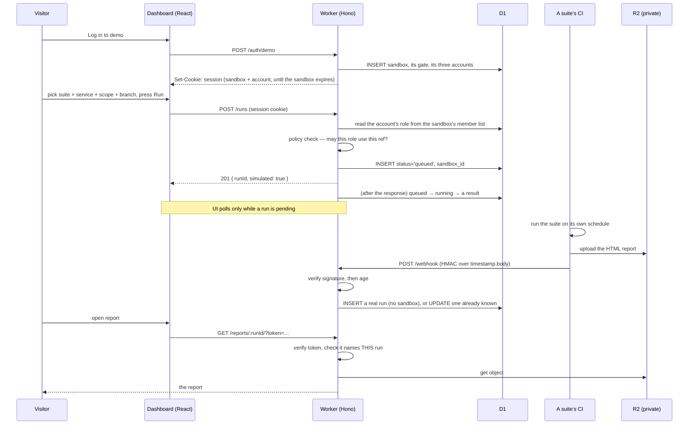

# Architecture

The main surfaces each have a different caller, and are authenticated
differently because they are trusted differently.

## The whole flow

Two flows now, and they never meet in a write: a visitor's runs are simulated
inside their sandbox, and the real runs arrive from the suites' own CI
([decision 52](decisions.md#52-a-demo-throughout-a-sandbox-for-each-visitor)).



**The suites' scheduled workflows do not post here yet.** Until they send a
callback naming what ran, the real runs shown are the ones recorded before the
dashboard stopped dispatching.

## The contract with the suites

Three repositories, no shared code, meeting at two points: the report a suite
uploads into this deployment's R2, and the callback it posts. There used to be
a third, the workflow inputs this dashboard dispatched with, and that is where
they had drifted — this dashboard sent a service name in a workflow input that
only accepted package names, and the workflow had no callback step at all.
Nothing is dispatched now.

**Callback — what comes back:**

```json
{
  "runId": "…",
  "status": "passed",
  "total": 80,
  "passed": 80,
  "failed": 0,
  "durationMs": 41200,
  "suiteVersion": "1.0.0",
  "suiteSha": "…",
  "reportPath": "runs/…/index.html",
  "workflowUrl": "https://github.com/…/actions/runs/…"
}
```

`durationMs` is how long the **suite** took, which is not how long the workflow
took — checkout, install and the browser download are not the suite. The two
workflows compute it differently and both are right: the API suite sums its
packages, because they run one after the other (they both bind port 4010 for
their own mock); the UI suite takes the longest, because its packages run at
once and adding them would report roughly twice the elapsed time.

Every field but `runId` and `status` is optional, and the three that name a
result — `reportPath`, `suiteVersion`, `suiteSha` — are `COALESCE`d rather than
overwritten, so a callback that omits one does not erase what an earlier one
recorded.

Signed over `timestamp.body` with a shared secret, and the workflow sends it
whether the suite passed or failed — a red run that never reports leaves the
dashboard showing `running` forever.

`suiteVersion` and `suiteSha` say which tree produced the result. The version is
what someone quotes; the sha is the only thing that identifies what actually ran,
and most runs happen between releases.

A callback for a run id this dashboard has not seen is recorded as a new real
run when it also carries `suite`, `service`, `tags` and `ref`; the suite must be
the one the signing secret is for. One for a sandbox's run is refused (`409`):
a CI run id is the workflow's own, and a clash means two writers disagree.

**Report upload — the second crossing.** The workflow writes the built report
straight into this deployment's R2 bucket under `runs/{run_id}/`, using a token
scoped to that one bucket, and only then claims `reportPath` in the callback. It
does not POST the bytes here: an endpoint accepting several megabytes needs a
body limit, a parser and a signing scheme over something too big to buffer, all
to reach a bucket the job can already write to. See
[decision 14](decisions.md#14-one-real-allure-report-shared-by-every-simulated-run).

## Why each surface authenticates differently

| Surface              | Caller                  | Authentication                               | Why                                                                    |
| -------------------- | ----------------------- | -------------------------------------------- | ---------------------------------------------------------------------- |
| `POST /auth/demo`    | a visitor               | none; makes a sandbox, capped per hour       | The way in is public by design; what it opens reaches only one sandbox |
| `POST /auth/account` | a visitor               | the sandbox's member list                    | The concept Google chooser; an account on no list is refused           |
| `POST /auth/admin`   | an account listed admin | the sandbox's admin key, limited per account | The second lock on admin; the only secret here worth guessing at       |
| `POST /runs`         | the dashboard           | session + role from the list + policy        | Needs to know _who_, to decide what they may run                       |
| `GET /runs`          | the dashboard, polling  | session, scoped in SQL by sandbox and role   | Needs to know who, to decide what they may see                         |
| `POST /webhook`      | a suite's CI            | HMAC over `timestamp.body`                   | The only endpoint that can write a real result                         |
| `GET /reports/*`     | a browser tab           | signed run-scoped token                      | Asset requests cannot carry a header                                   |
| `PUT /gate`          | an admin                | session + role                               | Pauses the sandbox's developer runs                                    |
| `/demo/admin/*`      | an admin, in person     | session + role, keys refused                 | Members, activity, lockdown — changing who may do what                 |

The webhook is the one worth attacking: it writes the numbers the dashboard
displays. Anyone who learned a run id and could post unsigned would be able to
mark a failing run green. So it is the one that is signed.

## The three questions authorisation answers

`src/policy.ts` is the only place these are decided:

```
1. may this role start a run?        →  POLICIES[role]
2. against which refs?               →  mayUseRef(role, ref)
3. which runs may it then see?       →  visibilityClause(role, sandbox)   ← SQL fragment
```

Question 3 returns a **SQL fragment**, not a predicate. The database must never
hand back a row the caller may not see — filtering after the query is a
convention, not a restriction, and it breaks under `LIMIT` besides. See
[decision 3](decisions.md#3-visibility-is-enforced-in-sql-never-in-the-handler).

|             | `dev`                                    | `qa`                              | `admin`                           |
| ----------- | ---------------------------------------- | --------------------------------- | --------------------------------- |
| Branches    | `main`                                   | `main`, `develop`, `release/*`    | any                               |
| Max workers | 4                                        | 8                                 | 16                                |
| Sees        | main-branch runs, real and its sandbox's | every run, real and its sandbox's | every run, real and its sandbox's |
| May delete  | no                                       | no                                | its sandbox's runs only           |

Every run started from the dashboard is simulated, whatever the role. A
sandbox's runs are never shown to another sandbox, and a real run — one with no
sandbox — is shown to all of them and deleted by none.

A run the caller may not see returns **404, not 403** — telling a developer that
a run exists but is off-limits leaks the branch names they were scoped away
from.

## Local versus deployed

Everything has a local implementation, so the repo runs with no account:

|           | Local (`pnpm dev`)              | Deployed                        |
| --------- | ------------------------------- | ------------------------------- |
| D1        | SQLite file under `.wrangler/`  | Cloudflare D1                   |
| R2        | a directory                     | Cloudflare R2                   |
| Runs      | simulated in-process            | simulated in-process            |
| Real runs | none, unless a callback is sent | the suites' CI posts them back  |
| Secrets   | obviously fake defaults         | `wrangler secret put`, required |

Which column applies is decided by the host a request reaches: a local name
(`localhost`, `127.0.0.1`, `*.test`, `*.localhost`) keeps the defaults; any
other refuses to serve without its secrets. There is no flag to forget.

## Data model

Runs are one table, and a sandbox's other state — its gate, members, keys and
activity — sits in tables keyed by `sandbox_id` (migration 0014). The id is human-readable on purpose —
`20260826-1430-items-k3f9qw` sorts chronologically, says what it covered, and
doubles as the R2 prefix for that run's report. A UUID would need a second
column to answer "when was this and what did it cover?", which is the question
anyone scanning the list is actually asking.

The random suffix is not decoration: without it, two runs of the same service in
the same minute collide on the PRIMARY KEY. That was a real 500 — see
[decision 9](decisions.md#9-the-bugs-the-tests-actually-found).

`suite` is a column rather than a convention inside `service`, because a `ui-`
prefix would be invisible to SQL: filtering, grouping and the trend chart would
each re-derive it by parsing, and each could parse it differently. See
[decision 24](decisions.md#24-a-second-suite-and-why-it-is-a-column-rather-than-a-naming-convention).

## Polling

The UI polls `GET /runs` only while at least one run is pending, and stops when
none are. A dashboard left open on a Friday afternoon should not still be
hitting the API on Monday.

The alternative — a WebSocket or SSE — is the right answer at a size this is not.
Runs finish in minutes, and only a handful of people would watch at once.
